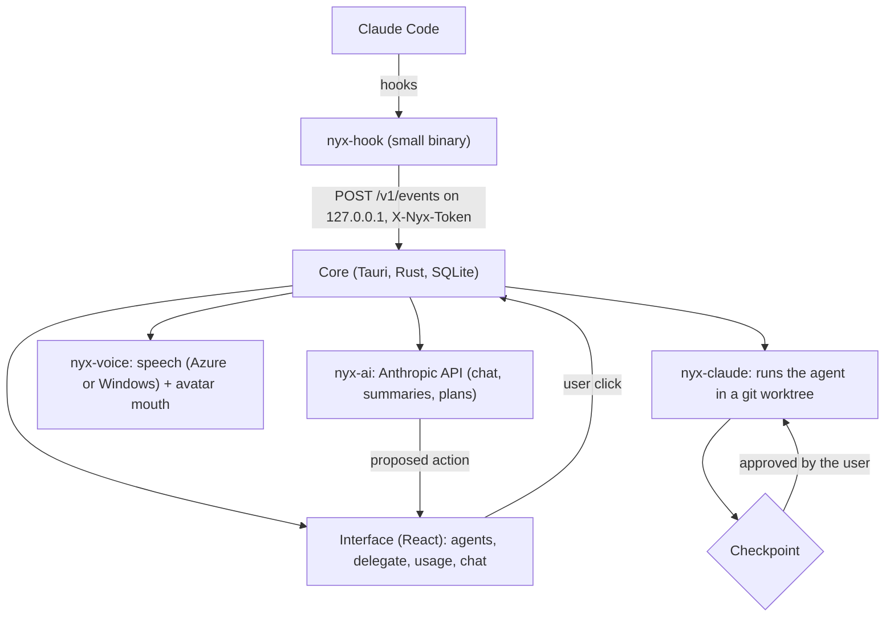

# 🌙 Nyx

**A Windows tray app that supervises coding agents such as Claude Code.**

🌐 **English** · [Português](README.pt-BR.md)

It warns when a session finishes or gets stuck, shows the week's usage, and delegates tasks in steps that only advance with your approval.

     

---

## 📌 About

Nyx sits in the system tray and follows the coding agent sessions running on the machine. Nyx is also a character: she reports what is happening in short lines, optionally read aloud, and always addresses the user as "Dev".

The core is written in Rust with Tauri 2, and the interface in React with TypeScript.

> **Project status:** MVP in development, with no published release. Windows only. The character's 3D model file is not in the repository (see [Avatar](#avatar)).

The core idea is human approval by construction:

> 🧠 **The model only proposes actions.**
> ⚙️ **The core only acts after a click from the user.**

## 📑 Table of Contents

- [Technologies](#-technologies)
- [Features](#-features)
- [The process](#-the-process)
- [What I learned](#-what-i-learned)
- [How can it be improved](#-how-can-it-be-improved)
- [Running the project](#-running-the-project)
- [License](#-license)

---

## 🛠 Technologies

| Area | Technology |
| --- | --- |
| Desktop shell | Tauri 2 (tray icon, notifications, autostart, single instance) |
| Core | Rust (edition 2021), Cargo workspace with six crates |
| Storage | SQLite through `rusqlite` 0.37 (bundled) |
| Local event server | `axum` 0.8 + `tokio` |
| Interface | React 19, TypeScript 6.0, Vite 8, Tailwind CSS 4 |
| 3D scene | three.js 0.180 + `@pixiv/three-vrm` 3.5 |
| AI (optional) | Anthropic API; default model `claude-haiku-5-5` |
| Voice (optional) | Azure Neural TTS, with the Windows voice as fallback |
| Tests | `cargo test` and Vitest 4 |

---

## 🚀 Features

### 👀 Session monitoring

A hook installed in Claude Code sends the events (end of turn, permission request, tool use) to the core, which shows the state of each session and raises a notice when something needs you. The installer merges the hook into the existing configuration without erasing what is already there.

### 🪜 Delegation in steps

A delegation is a list of steps. Each step runs the agent in non-interactive mode inside a separate git worktree and stops at a checkpoint, with a summary, until you approve the next one. You can ask for an adjustment instead of approving, and a step that tries to use a tool outside the allowed list is blocked.

### 💬 Chat and proposals

With AI turned on (optional), Nyx answers in the chat and can propose actions. The model's tools only generate proposals: no action is executed without approval.

| Proposal (`ChatAction.kind`) | Purpose |
| --- | --- |
| `startDelegation` | Create and start a delegation in steps |
| `approveStep` | Approve the step waiting for approval |
| `adjustStep` | Ask the agent to redo the current step with an adjustment |
| `installHooks` | Install the hooks |
| `openPanel` | Open a panel of the app |
| `createContext` | Create a project context |

### 🔊 Voice

Notices can be read aloud, by Azure Neural TTS or by the Windows voice as fallback.

### 📊 Usage

Tokens per session, per day and per week, with CSV export.

### 🗂 Interface

Seven tabs: Agentes, Delegar, Uso, Eventos, Contextos, Nyx (chat) and Config.

### Avatar

The default scene is a 2D portrait. The 3D avatar is a beta option that uses a VRM model, which is not versioned. Place a `.vrm` file at `app/public/models/nyx.vrm` to see the character in 3D; without a model, the scene falls back to the portrait. Appearance and tone of voice are described in `docs/PERSONAGEM.md`.

---

## 🔄 The process



### 1. Events

`nyx-hook` is a small binary called by the Claude Code hooks. It forwards each event to a local server in the core (`POST /v1/events` on `127.0.0.1`, on a port chosen by the operating system, authenticated by the `X-Nyx-Token` header). The server answers 202 and the processing happens outside the request.

### 2. Delegation

Each delegation gets its own git worktree and branch. The core starts one non-interactive agent process per step, records the result, and waits at a checkpoint. When a session gets long, the agent writes a hand-off file (`PASSAGEM.md`) at the worktree root and the next session starts from it.

### 3. Proposals

The chat offers `propose_*` tools to the model. Each tool call becomes a `ProposedAction` shown as a button; the core runs it only after the click.

### 4. Contract first

The interface and the core talk through a typed contract (`app/src/api/contract.ts`), with a complete simulation of the core (`app/src/api/mock.ts`) to develop the interface without Rust.

### 5. Project layout

| Path | Contents |
| --- | --- |
| `app/src-tauri/` | Core: sessions, delegations, chat, usage, notices and SQLite database |
| `app/src/` | React interface: tabs, 3D scene, API client and simulations for development |
| `crates/nyx-claude/` | Reading of hook events and execution of the agent in non-interactive mode |
| `crates/nyx-hook/` | Hook binary and installer, which merges the configuration without erasing the existing one |
| `crates/nyx-ai/` | Anthropic API client, with tools that only propose actions |
| `crates/nyx-voice/` | Speech synthesis, text normalization, cache and playback queue |
| `crates/nyx-fakeclaude/` | Simulated agent, used in tests in place of the real one |
| `docs/` | MVP specifications and the character sheet |

---

## 📚 What I learned

### Tools that only propose

Making every model tool return a proposal, and leaving execution to the core after a click, puts human approval in the structure of the program instead of in the prompt.

### One git worktree per delegation

Running each delegation in its own copy of the repository means a bad step does not touch the user's working tree, and discarding the work is removing a worktree.

### A typed contract with a full mock

Writing the contract between interface and core first, and keeping a complete simulation of the core, let me develop and test the interface without building the Rust side.

### A fake agent for tests

`nyx-fakeclaude` behaves like the agent's command line and prints synthetic output for several scenarios (success, error, long session, blocked tool). With it, the delegation tests run without calling any API.

### Merging configuration instead of overwriting it

Installing a hook means editing a settings file the user already owns. I learned to merge into it and keep what was there.

### A local event server should answer quickly

The hook cannot hold the agent back, so the server only authenticates, queues the event and answers 202; the work happens afterwards.

### Optional AI

Keeping chat, summaries and plans behind an optional key forced the rest of the app to work without them.

---

## 🔮 How can it be improved

| Improvement | Description |
| --- | --- |
| **Other operating systems** | Windows only. |
| **Other agents** | Only Claude Code has an adapter; other command-line agents do not yet. |
| **Voice without an own key** | The Azure voice requires your own key, kept outside the repository. |
| **Published release** | There is no published release; the app runs from source. |
| **3D model** | The VRM model is not in the repository and the 3D avatar is still beta. |

---

## ▶ Running the project

### Requirements

- Windows
- Rust (stable toolchain)
- Node.js 20 or newer
- The Tauri 2 prerequisites for Windows
- Git

### 1. Clone the repository

```bash
git clone <repository-url>
cd nyx
```

### 2. Run the app

```powershell
cd app
npm install
npm run tauri dev
```

### 3. Run only the interface, with the simulated core

```powershell
cd app
npm run dev
```

The interface opens at `http://localhost:1420`.

### 4. Optional settings

AI and Azure voice are off until their environment variables are set. Never commit keys.

| Variable | Purpose |
| --- | --- |
| `NYX_ANTHROPIC_API_KEY` | Turns on chat, summaries and plans (`ANTHROPIC_API_KEY` is accepted as a fallback) |
| `NYX_AZURE_SPEECH_KEY`, `NYX_AZURE_SPEECH_REGION` | Turn on the Azure voice |

### Running the tests

```powershell
cd app
npm install
npm run sidecar        # builds the hook binary that the core embeds
npm test
cd ..
cargo test --workspace
```

The tests use the simulated agent and fake clients, so they do not call any API.

---

## 📄 License

MIT. See [LICENSE](LICENSE).
