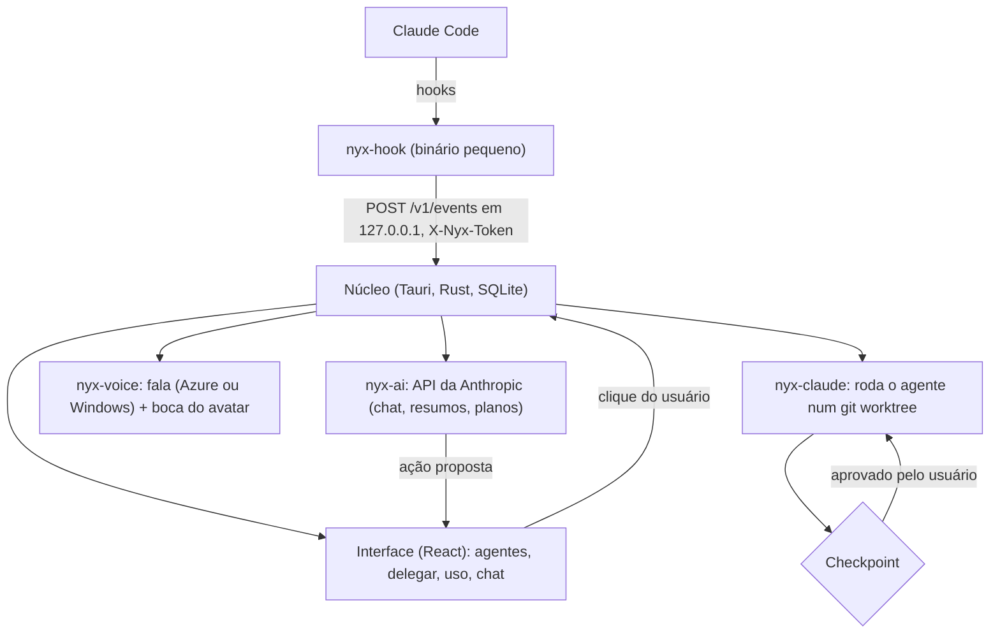

# 🌙 Nyx

**Um aplicativo de bandeja para Windows que supervisiona agentes de código, como o Claude Code.**

🌐 [English](README.md) · **Português**

Ele avisa quando uma sessão termina ou trava, mostra o uso da semana, e delega tarefas em etapas que só avançam com a sua aprovação.

     

---

## 📌 Sobre

A Nyx fica na bandeja do sistema e acompanha as sessões de agentes de código que rodam na máquina. A Nyx é também uma personagem: ela relata o que está acontecendo em falas curtas, que podem ser lidas em voz alta, e sempre trata o usuário por "Dev".

O núcleo é escrito em Rust com Tauri 2, e a interface em React com TypeScript.

> **Estado do projeto:** MVP em desenvolvimento, sem versão publicada. Só Windows. O arquivo do modelo 3D da personagem não está no repositório (veja [Avatar](#avatar)).

A ideia central é a aprovação humana por construção:

> 🧠 **O modelo só propõe ações.**
> ⚙️ **O núcleo só age depois de um clique do usuário.**

## 📑 Sumário

- [Tecnologias](#-tecnologias)
- [Funcionalidades](#-funcionalidades)
- [O processo](#-o-processo)
- [O que aprendi](#-o-que-aprendi)
- [Como pode melhorar](#-como-pode-melhorar)
- [Como rodar o projeto](#-como-rodar-o-projeto)
- [Licença](#-licença)

---

## 🛠 Tecnologias

| Área | Tecnologia |
| --- | --- |
| Casca desktop | Tauri 2 (ícone de bandeja, notificações, início automático, instância única) |
| Núcleo | Rust (edição 2021), workspace Cargo com seis crates |
| Armazenamento | SQLite pelo `rusqlite` 0.37 (embutido) |
| Servidor local de eventos | `axum` 0.8 + `tokio` |
| Interface | React 19, TypeScript 6.0, Vite 8, Tailwind CSS 4 |
| Cena 3D | three.js 0.180 + `@pixiv/three-vrm` 3.5 |
| IA (opcional) | API da Anthropic; modelo padrão `claude-haiku-5-5` |
| Voz (opcional) | Azure Neural TTS, com a voz do Windows como reserva |
| Testes | `cargo test` e Vitest 4 |

---

## 🚀 Funcionalidades

### 👀 Acompanhamento das sessões

Um hook instalado no Claude Code envia os eventos (fim de turno, pedido de permissão, uso de ferramenta) para o núcleo, que mostra o estado de cada sessão e dispara um aviso quando algo precisa de você. O instalador mescla o hook na configuração existente sem apagar o que já está lá.

### 🪜 Delegação em etapas

Uma delegação é uma lista de passos. Cada passo roda o agente em modo não interativo dentro de um git worktree separado e para num checkpoint, com um resumo, até você aprovar o próximo. Você pode pedir um ajuste em vez de aprovar, e um passo que tenta usar uma ferramenta fora da lista permitida é bloqueado.

### 💬 Chat e propostas

Com a IA ligada (opcional), a Nyx responde no chat e pode propor ações. As ferramentas do modelo só geram propostas: nenhuma ação é executada sem aprovação.

| Proposta (`ChatAction.kind`) | Finalidade |
| --- | --- |
| `startDelegation` | Criar e iniciar uma delegação em etapas |
| `approveStep` | Aprovar a etapa que aguarda aprovação |
| `adjustStep` | Pedir ao agente que refaça a etapa atual com um ajuste |
| `installHooks` | Instalar os hooks |
| `openPanel` | Abrir um painel do aplicativo |
| `createContext` | Criar um contexto de projeto |

### 🔊 Voz

Os avisos podem ser lidos em voz alta, por Azure Neural TTS ou pela voz do Windows como reserva.

### 📊 Uso

Tokens por sessão, por dia e por semana, com exportação em CSV.

### 🗂 Interface

Sete abas: Agentes, Delegar, Uso, Eventos, Contextos, Nyx (chat) e Config.

### Avatar

A cena padrão é um retrato 2D. O avatar 3D é uma opção beta que usa um modelo VRM, que não está versionado. Coloque um arquivo `.vrm` em `app/public/models/nyx.vrm` para ver a personagem em 3D; sem um modelo, a cena volta para o retrato. A aparência e o tom de voz estão descritos em `docs/PERSONAGEM.md`.

---

## 🔄 O processo



### 1. Eventos

O `nyx-hook` é um binário pequeno chamado pelos hooks do Claude Code. Ele encaminha cada evento a um servidor local no núcleo (`POST /v1/events` em `127.0.0.1`, numa porta escolhida pelo sistema operacional, autenticado pelo cabeçalho `X-Nyx-Token`). O servidor responde 202 e o processamento acontece fora da requisição.

### 2. Delegação

Cada delegação recebe um git worktree e um branch próprios. O núcleo inicia um processo não interativo do agente por passo, registra o resultado e espera num checkpoint. Quando uma sessão fica longa, o agente escreve um arquivo de passagem (`PASSAGEM.md`) na raiz do worktree e a sessão seguinte parte dele.

### 3. Propostas

O chat oferece ferramentas `propose_*` ao modelo. Cada chamada de ferramenta vira uma `ProposedAction` exibida como botão; o núcleo só a executa depois do clique.

### 4. Contrato primeiro

A interface e o núcleo conversam por um contrato tipado (`app/src/api/contract.ts`), com uma simulação completa do núcleo (`app/src/api/mock.ts`) para desenvolver a interface sem o Rust.

### 5. Estrutura do projeto

| Caminho | Conteúdo |
| --- | --- |
| `app/src-tauri/` | Núcleo: sessões, delegações, chat, uso, avisos e banco SQLite |
| `app/src/` | Interface em React: abas, cena 3D, cliente da API e simulações para desenvolvimento |
| `crates/nyx-claude/` | Leitura dos eventos de hook e execução do agente em modo não interativo |
| `crates/nyx-hook/` | Binário do hook e instalador, que mescla a configuração sem apagar a que já existe |
| `crates/nyx-ai/` | Cliente da API da Anthropic, com ferramentas que só propõem ações |
| `crates/nyx-voice/` | Síntese de fala, normalização de texto, cache e fila de reprodução |
| `crates/nyx-fakeclaude/` | Agente simulado, usado nos testes no lugar do real |
| `docs/` | Especificações do MVP e a ficha da personagem |

---

## 📚 O que aprendi

### Ferramentas que só propõem

Fazer cada ferramenta do modelo devolver uma proposta, e deixar a execução com o núcleo depois de um clique, coloca a aprovação humana na estrutura do programa em vez de no prompt.

### Um git worktree por delegação

Rodar cada delegação numa cópia própria do repositório faz com que um passo ruim não mexa na árvore de trabalho do usuário, e descartar o trabalho é remover um worktree.

### Um contrato tipado com uma simulação completa

Escrever primeiro o contrato entre interface e núcleo, e manter uma simulação completa do núcleo, me permitiu desenvolver e testar a interface sem compilar o lado Rust.

### Um agente falso para os testes

O `nyx-fakeclaude` se comporta como a linha de comando do agente e imprime uma saída sintética para vários cenários (sucesso, erro, sessão longa, ferramenta bloqueada). Com ele, os testes de delegação rodam sem chamar nenhuma API.

### Mesclar a configuração em vez de sobrescrever

Instalar um hook significa editar um arquivo de configuração que já é do usuário. Aprendi a mesclar nele e manter o que já estava lá.

### Um servidor local de eventos deve responder rápido

O hook não pode segurar o agente, então o servidor só autentica, enfileira o evento e responde 202; o trabalho acontece depois.

### IA opcional

Manter chat, resumos e planos atrás de uma chave opcional obrigou o resto do aplicativo a funcionar sem eles.

---

## 🔮 Como pode melhorar

| Melhoria | Descrição |
| --- | --- |
| **Outros sistemas operacionais** | Só Windows. |
| **Outros agentes** | Só o Claude Code tem adaptador; outros agentes de linha de comando ainda não. |
| **Voz sem chave própria** | A voz por Azure exige uma chave sua, guardada fora do repositório. |
| **Versão publicada** | Não há versão publicada; o aplicativo roda a partir do código-fonte. |
| **Modelo 3D** | O modelo VRM não está no repositório e o avatar 3D ainda é beta. |

---

## ▶ Como rodar o projeto

### Requisitos

- Windows
- Rust (toolchain estável)
- Node.js 20 ou mais novo
- Os pré-requisitos do Tauri 2 para Windows
- Git

### 1. Clonar o repositório

```bash
git clone <repository-url>
cd nyx
```

### 2. Rodar o aplicativo

```powershell
cd app
npm install
npm run tauri dev
```

### 3. Rodar só a interface, com o núcleo simulado

```powershell
cd app
npm run dev
```

A interface abre em `http://localhost:1420`.

### 4. Configurações opcionais

A IA e a voz por Azure ficam desligadas até que suas variáveis de ambiente sejam definidas. Nunca faça commit de chaves.

| Variável | Finalidade |
| --- | --- |
| `NYX_ANTHROPIC_API_KEY` | Liga chat, resumos e planos (`ANTHROPIC_API_KEY` é aceita como reserva) |
| `NYX_AZURE_SPEECH_KEY`, `NYX_AZURE_SPEECH_REGION` | Ligam a voz por Azure |

### Rodando os testes

```powershell
cd app
npm install
npm run sidecar        # gera o binário do hook que o núcleo embute
npm test
cd ..
cargo test --workspace
```

Os testes usam o agente simulado e clientes falsos, então não chamam nenhuma API.

---

## 📄 Licença

MIT. Veja [LICENSE](LICENSE).
